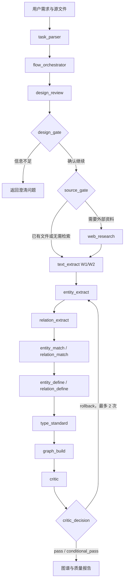

# 通用版架构说明

## 主图与执行子图

主图 `src/graphs/graph.py` 承载 Planner、设计确认、来源路由和子图调用。`src/graphs/loop_graph.py` 是 Worker-Critic 执行子图，Critic 决策把需要重跑的任务送回执行流程。实际重试上限由循环图配置控制。

## 三层职责

| 层 | 节点 | 主要职责 | 关键输出 |
| --- | --- | --- | --- |
| Planner | `task_parser`, `flow_orchestrator` | 解析领域、下游用途和约束；规划节点/关系/属性、词表、来源模式、质量门和领域提示词 | `task_contract`, `execution_plan`, `domain_profile` |
| 设计确认与来源 | `design_review`, `design_gate`, `source_gate`, `web_research` | 暴露候选设计并询问缺失信息；在文档输入和联网研究间路由 | `design_proposal`, `confirmation_questions`, `research_text` |
| Worker | W1/W2 至 W10 | 文本提取、实体/关系抽取、匹配、定义、标准化和构图 | 带领域属性和来源信息的 `knowledge_graph` |
| Critic | `critic`, `critic_decision` | 评估实体、关系、图连通性与类型平衡；给出放行、回滚或人工复核建议 | `quality_report`, `decision` |

Worker 的十个职责编号为：W1/W2 文本提取与清洗，W3 实体抽取，W4 关系抽取，W5 实体匹配，W6 关系匹配，W7 实体定义，W8 关系定义，W9 类型标准化，W10 图谱构建。

## 数据与配置

- `src/graphs/state.py` 定义主图的 `GraphInput` / `GraphOutput`、全局状态和节点级数据契约。
- `config/*_llm_cfg.json` 分别保存 Agent 的模型参数和系统/用户提示模板；API 身份由 Coze 运行环境提供，不应写进 JSON。
- `src/utils/llm_helper.py` 按节点元数据加载配置，渲染提示并调用 Coze LLM SDK。
- `src/utils/file/file.py` 负责读取本地或远程文件；`text_extract_node.py` 将其交给后续 Worker。
- `src/storage/` 包含关系数据库、检查点和 S3 对象存储适配。部署时还需配置相应服务与访问权限。

## 质量门与解释

Critic 设计为四维评分：实体准确、关系准确、图连通、图平衡。决策受任务的质量阈值影响；低分可触发有限重试，关键问题应进入人工核查。代码生成的分数不是人工金标准指标。要把它用于跨版本比较，应固定输入、模型、提示、阈值和人工标注规则，并单独记录评测集。
